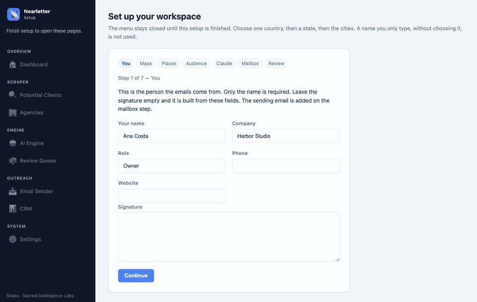

<p align="center">
  <a href="https://sacredintelligencelabs.com.au">
    
  </a>
</p>

# Nearletter

Local business outreach. Find nearby businesses, write one email at a time, read it, then send it yourself.



The animation is an example install. Country, state, and city are example places. The key checks and the mailbox are answered on the computer that recorded it. No Google, Claude, or email account is contacted, and no real key is on screen.

Nearletter is a local program for one person. It runs on your computer. There is no account, no cloud host, and no automatic sending. The path is always the same: search, draft, review, approve or reject, send.

Built by [Silabs](https://sacredintelligencelabs.com.au), Sacred Intelligence Labs.

## What each part does

| Page | What it does |
| --- | --- |
| Setup | First launch only. You choose one country, then a state, then cities. Google confirms each place. You also save your Maps key, your niches, your Claude key, and your mailbox. |
| Potential Clients | Searches Google Maps for local businesses in the cities you chose and scores how easy they are to contact. |
| Agencies | Searches for agencies in those places. |
| AI Engine | Asks Claude for a draft. Claude does not send anything. |
| Review Queue | You read every draft. Approve it or reject it. |
| Email Sender | Sends only the emails you approved, through Gmail or your own mailbox. |
| CRM | Keeps the local history. You can export a CSV. Google Sheets is optional. |
| Settings | Change the mailbox, the keys, the daily send limit, and the saved places. |

Agencies go out through the Gmail mailbox. Potential clients go out through the custom mailbox. If you only have one mailbox, use Gmail and leave the custom fields empty.

## Install

You need Python 3.10, 3.11, 3.12, or 3.13.

Mac or Linux:

```bash
./start.sh
```

Windows:

```bat
start.bat
```

The launcher creates `venv`, installs the requirements, and opens the app at [http://127.0.0.1:8000](http://127.0.0.1:8000). It listens only on your own computer. If port 8000 is already in use, it stops and tells you. It does not close the other program.

A fresh download has no `.env` and no profile, so the setup assistant opens first. A computer that was already configured skips that assistant.

## Accounts you create

Nothing here is filled in for you. You paste your own keys. The program does not invent an email address for a company.

1. **Google Maps.** In [Google Cloud](https://console.cloud.google.com/), create a key and enable Places API (the legacy Places endpoints this app calls: Find Place, Place Details, Nearby Search, Text Search, and Place Autocomplete). Put the key in Setup, or later in Settings as `GOOGLE_MAPS_API_KEY`.
2. **Claude.** Create a key in the [Anthropic console](https://console.anthropic.com/). The app uses it only to write drafts.
3. **Mailbox.** Gmail needs an [App Password](https://myaccount.google.com/apppasswords), not your normal Google password. A custom mailbox needs the host, port, username, and password from that provider. The daily send limit defaults to 25. Safe Mode starts on, so a batch send stays blocked until you turn it off.
4. **Google Sheets, optional.** Create a Google Cloud service account, download the JSON, and save it as `google-service-account.json` in this folder. Put the spreadsheet id in `GOOGLE_SHEETS_ID`. Without that file, the local CRM and CSV export still work.
5. **Resume, optional.** To attach a PDF to agency emails, put it at `static/assets/resume.pdf`.

Copy `.env.example` to `.env` only if you want to edit keys by hand. Setup writes the same file for you.

## What stays on your computer

These files are yours. They are not part of the public project:

- `.env` — keys and mailbox passwords
- `profile.json` — the setup answers
- `outreach.db` — leads, drafts, and sent mail
- `google-service-account.json`
- `static/assets/resume.pdf`

Do not commit them.

## License

MIT. Copyright 2026 Sacred Intelligence Labs. See [LICENSE](LICENSE).
